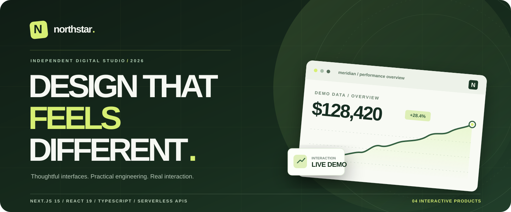
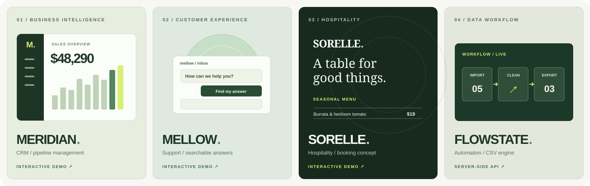

<div align="center">



<br />

<a href="https://northstar-portfolio-studio.vercel.app/"></a>
&nbsp;
<a href="https://northstar-portfolio-studio.vercel.app/#showcase"></a>
&nbsp;
<a href="https://northstar-portfolio-studio.vercel.app/contact"></a>

<br /><br />

**Design that works. Code that matters. Details worth noticing.**

An independent, design-led portfolio built with **Next.js, React and TypeScript** — featuring four interactive product concepts, a real server-side CSV API, and a cohesive Forest & Citron design system.

<sub>Interactive portfolio / Full-stack demonstrations / 2026</sub>

</div>

<br />

---

## 01 — An experience, not another template

**Northstar** is a portfolio and product showcase for clients who care about both appearance and functionality.

This project combines expressive editorial typography, quiet motion, practical UI patterns, and working demonstrations into one cohesive website.

- **Visual identity:** warm off-white, deep forest green and electric citron.
- **Typography:** Syne for confident display headings; DM Sans for readable interfaces.
- **Interaction:** responsive navigation, project carousel, live workspaces, form states and keyboard-aware controls.
- **Architecture:** Next.js App Router, typed React components, route metadata, server-side endpoints and optional private persistence.
- **Scope:** **20 additional portfolio pages** covering services, pricing, case studies, process, FAQs, contact and legal information.

> [!NOTE]
> Northstar is a **portfolio demonstration**. The sample brands, figures, records and bookings are illustrative. This repository is **not** a claim of completed paid client commissions or four production SaaS platforms.

<br />

## 02 — Selected work / Four interactive experiences

<a href="https://northstar-portfolio-studio.vercel.app/#showcase">

</a>

<br />

<table>
<tr>
<td width="50%" valign="top">

### 01 / Meridian CRM

**Business intelligence · Sales workflow**

A compact CRM workspace built around useful numbers and editable records.

- Create, search and delete opportunities
- Update pipeline stages
- Recalculate active deals, pipeline value and won revenue
- Export a CSV snapshot
- Restore demo state in the same browser

<a href="https://northstar-portfolio-studio.vercel.app/case-meridian"><b>Explore the case study ↗</b></a>

</td>
<td width="50%" valign="top">

### 02 / Mellow Support

**Customer experience · Knowledge retrieval**

A focused help interface that prioritizes clear answers over AI theater.

- Chat with a searchable knowledge base
- Add and edit knowledge articles
- Retain demo conversation state
- Show an explicit fallback for unknown questions
- Keep a clean, responsive support layout

<a href="https://northstar-portfolio-studio.vercel.app/case-mellow"><b>Explore the case study ↗</b></a>

</td>
</tr>
<tr>
<td valign="top">

### 03 / Sorelle

**Hospitality · Reservation concept**

A fictional restaurant experience with a practical booking flow.

- Browse a seasonal sample menu
- Switch the hero copy between English and Russian
- Select a date, time and party size
- Validate booking details and check a demo capacity limit
- Save simulated reservations for a browser session

<a href="https://northstar-portfolio-studio.vercel.app/case-sorelle"><b>Explore the case study ↗</b></a>

</td>
<td valign="top">

### 04 / Flowstate

**Data tools · Server-side automation**

A lightweight CSV-cleaning workspace with a real Next.js API route.

- Import a CSV file or paste CSV text
- Trim whitespace and remove blank records
- Deduplicate rows while preserving the header
- Inspect input/output counts and validation errors
- Download the cleaned CSV file

<a href="https://northstar-portfolio-studio.vercel.app/case-flowstate"><b>Explore the case study ↗</b></a>

</td>
</tr>
</table>

<p align="right"><a href="https://northstar-portfolio-studio.vercel.app/#showcase"><b>OPEN INTERACTIVE PLAYGROUND ↗</b></a></p>

---

## 03 — Technologies & languages

<div align="center">

**LANGUAGES & MARKUP**


<br />

**FRAMEWORK, RUNTIME & TOOLING**


<br />

**PERSISTENCE & DATA**


</div>

| Layer | Implementation |
|:--|:--|
| **Primary source language** | TypeScript, with TSX for React UI |
| **Browser/runtime language** | JavaScript, produced from TypeScript |
| **Structure & styles** | JSX / HTML output, CSS |
| **Frontend** | React 19.1.1, Next.js 15.5.12 App Router |
| **Backend** | Next.js Route Handlers on Node.js |
| **Storage** | Private Vercel Blob if configured; browser-local cache fallback |
| **Icons** | Lucide React and React Icons |
| **Hosting** | Vercel |
| **Fonts** | Syne and DM Sans via Google Fonts |

**Important distinction:** Python is among the types of automation work described in the studio's services, **but this repository itself is a TypeScript / Next.js application**. There is no Python backend, SQL database or connected generative AI model in the public demo.

---

## 04 — How it works

```text
                        NORTHSTAR STUDIO
                               │
                   Next.js 15 / React 19
                               │
                 ┌─────────────┴──────────────┐
                 │                            │
           Portfolio pages               Live showcase
          (20 extra routes)               (4 products)
                 │                            │
         App Router + SEO             Client-side state
                                              │
                              ┌───────────────┴───────────────┐
                              │                               │
                     Workspace API                      CSV API
                     GET / PUT                          POST
                              │                               │
                      Private Blob*                  In-memory cleanup
                      + local cache                 + validated CSV export
```

`* Vercel Blob persistence is optional and requires server-side configuration.`

### API reference

| Endpoint | Method | What it does |
|:--|:--|:--|
| `/api/workspace?kind=deals` | `GET`, `PUT` | Read/write the current browser's CRM records |
| `/api/workspace?kind=knowledge` | `GET`, `PUT` | Save knowledge-base articles |
| `/api/workspace?kind=chat` | `GET`, `PUT` | Save demo conversation history |
| `/api/workspace?kind=bookings` | `GET`, `PUT` | Save simulated reservation records |
| `/api/automation` | `POST` | Validate, parse, trim and deduplicate CSV |

**Demo limits:** CSV is limited to approximately **100 KB / 2,000 rows**. Workspace data is schema-validated, limited to **80 records per workspace**, and uses an anonymous, HttpOnly, SameSite session cookie when server storage is configured. These are demo safeguards, **not** production authentication.

### Project structure

```text
northstar-portfolio/
├── app/
│   ├── page.tsx                  # Homepage + four interactive demos
│   ├── [slug]/page.tsx           # Twenty content and case-study routes
│   ├── StudioPage.tsx            # Route-specific page compositions
│   ├── StudioPrinciples.tsx      # Interactive design principles
│   ├── SiteChrome.tsx            # Shared site header + footer
│   ├── portfolio-pages.ts       # Page registry and content
│   ├── api/
│   │   ├── workspace/route.ts    # Session-scoped demo persistence
│   │   └── automation/route.ts   # CSV processing endpoint
│   ├── layout.tsx                # Global metadata, fonts and chrome
│   ├── icon.svg                  # Favicon
│   ├── opengraph-image.tsx       # Social preview
│   └── *.css                     # Typography, layouts and motion
├── docs/
│   ├── readme-hero.svg           # Custom README artwork
│   └── readme-showcase.svg       # Four-project overview
├── package.json
├── tsconfig.json
└── next.config.ts
```

---

## 05 — Run it locally

**Requirements:** Node.js 20 LTS (recommended) and npm.

```bash
git clone https://github.com/Akopyan0/Northstar---Portfolio.git
cd Northstar---Portfolio
npm install
npm run dev
```

Open **http://localhost:3000**.

The UI and browser-local demo state work without purchasing a service or connecting a database. The CSV processor runs in the Next.js server.

### Optional private workspace persistence

Create `.env.local` if you connect a private Vercel Blob store:

```dotenv
BLOB_READ_WRITE_TOKEN=your_private_vercel_blob_token
```

Use the token **only on the server**, never in browser code or a public commit. If Blob is not configured, the UI uses its browser-local fallback rather than claiming to have saved state in a shared database.

### Build & typecheck

```bash
npm run lint      # project script: TypeScript type-check (tsc --noEmit)
npm run build     # optimized Next.js production build
npm run start     # start the production server
```

---

## 06 — What is ready & what is next

| Area | Current status |
|:--|:--|
| Branded, responsive portfolio | **Implemented** |
| Four interactive browser demonstrations | **Implemented** |
| Twenty additional pages and case studies | **Implemented** |
| Server-side CSV validation and processing | **Implemented** |
| Session-scoped persistence API | **Implemented; requires private Blob configuration** |
| Metadata, Open Graph, favicon, sitemap | **Implemented** |
| Actual restaurant booking provider | **Not integrated** |
| Generative LLM assistant | **Not integrated** |
| Real users, roles and team permissions | **Not implemented** |
| Production-grade data storage and transaction safety | **Not implemented** |
| Automated browser E2E, accessibility and performance audit | **Still recommended before client deployment** |
| Real contact submission / email delivery | **Not integrated; project brief and links are available** |

### Next engineering milestones

1. **Quality assurance** — test every navigation path, carousel state, form, mobile layout and API error; add Playwright E2E coverage and an accessibility audit.
2. **Persistence & security** — if turning demos into real products, add accounts, authorization, transactional storage, stronger rate limiting, retention controls and observability.
3. **Production integrations** — replace simulated bookings with a verified restaurant provider; add an optional LLM only with appropriate controls; integrate contact delivery if needed.
4. **Delivery polish** — optimize image/font loading, document environment configuration and add repeatable deployment checks.

> [!IMPORTANT]
> **Portfolio-ready does not mean customer-production-ready.** You can browse, interact with and evaluate the demos now. They are not connected to real businesses. Do not enter real customer, payment or other sensitive data into public demonstrations.

---

## 07 — Studio pages

**Discover:** [Services](https://northstar-portfolio-studio.vercel.app/services) · [Selected work](https://northstar-portfolio-studio.vercel.app/work) · [Pricing](https://northstar-portfolio-studio.vercel.app/pricing) · [Process](https://northstar-portfolio-studio.vercel.app/process)

**Capabilities:** [Web design](https://northstar-portfolio-studio.vercel.app/web-design) · [Business dashboards](https://northstar-portfolio-studio.vercel.app/dashboards) · [AI-ready support interfaces](https://northstar-portfolio-studio.vercel.app/ai-support) · [Automation](https://northstar-portfolio-studio.vercel.app/automation) · [Restaurant websites](https://northstar-portfolio-studio.vercel.app/restaurant-websites)

**More:** [Studio](https://northstar-portfolio-studio.vercel.app/studio) · [FAQ](https://northstar-portfolio-studio.vercel.app/faq) · [Contact](https://northstar-portfolio-studio.vercel.app/contact) · [Legal](https://northstar-portfolio-studio.vercel.app/legal)

---

## 08 — Credits, ownership & license

- **Design and development:** [Akopyan0](https://github.com/Akopyan0) / Northstar Studio.
- **Typefaces:** Google Fonts — Syne and DM Sans.
- **Iconography:** [Lucide](https://lucide.dev/) and React Icons.
- **README artwork:** original SVG compositions made for this repository. Product figures in these illustrations are sample data.
- **Sample content:** fictional brands, examples and revenue; not claimed as actual customer results.
- **License:** [MIT](./LICENSE).

<div align="center">

<br />

### HAVE SOMETHING WORTH BUILDING?

**Make it thoughtful. Make it useful. Make it memorable.**

<a href="https://northstar-portfolio-studio.vercel.app/contact"></a>

<br /><br />

<sub>© 2026 Northstar Studio · Built with intention.</sub>

</div>
